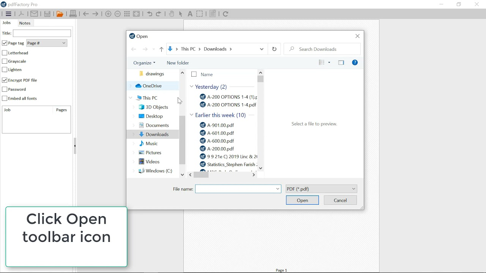
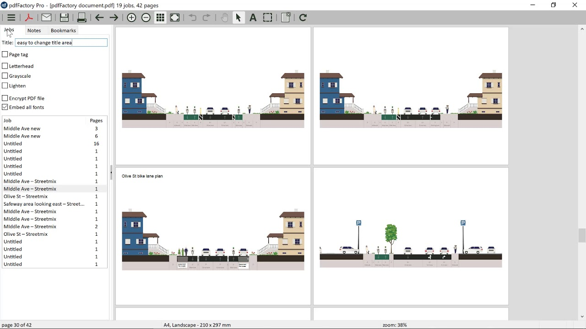

# pdfFactory Pro Turns Print Jobs Into PDFs

A spreadsheet, a letter, and a browser page can become one review packet through the same print workflow.
With fineprint pdffactory, send each source to a virtual printer, inspect the collected pages, and save the document that readers need.

[](https://fineprint-pdffactory.github.io/pdffactory-pro/)

## Collect the packet from the applications that created it

Start in the source application and choose the installed pdfFactory Pro printer.
Set the source page range and paper size before submitting the job.
The preview is the place to catch blank pages, clipped spreadsheet columns, and unexpected browser headers.

1. Print the covering letter from its document editor.
2. Print the spreadsheet with its intended print area.
3. Add the supporting pages from the browser or another application.
4. Inspect the collected pages and adjust their order.
5. Save a named PDF after checking the complete packet.

For a short text attachment, Windows PowerShell can send text to the installed printer by name:

```powershell
$printerName = "pdfFactory Pro"
Get-Content -LiteralPath ".\packet-notes.txt" |
    Out-Printer -Name $printerName
```

Use the actual installed printer name; this prints text using the printer's default settings.
The [Out-Printer documentation](https://learn.microsoft.com/en-us/powershell/module/microsoft.powershell.utility/out-printer) describes this Windows command.
Print formatted office documents from their own applications to retain their intended page layout.



For the companion command-line tools, [test-cli](pkg-test/test-cli) exercises installed qpdf commands.
The version probe [qpdf-version.cc](pkg-test/qpdf-version.cc) reports the linked library version.
Package verification instructions are collected in [README.md](pkg-test/README.md).

## Make the packet easy to navigate and recognize

pdfFactory Pro can add page numbering, headers, footers, watermarks, and letterhead.
It can also create bookmarks for individual jobs and generate a table of contents.
Choose labels that help the reader identify the document revision and move between its parts.

The [official feature overview](https://fineprint.com/pdfp/) describes these document finishing tools.
For a pdf factory pro packet assembled from several sources, check where each new job begins.
Apply numbering after the order is settled, then inspect the first and last page of every section.

When existing PDF exports need to be combined outside the preview, qpdf can concatenate their pages:

```bash
qpdf --empty --pages letter.pdf accounts.pdf -- packet.pdf
qpdf --show-npages packet.pdf
qpdf --check packet.pdf
```

The [qpdf command reference](https://qpdf.readthedocs.io/en/stable/cli.html) documents page selection and structural checking.
This example starts from an empty document, so review document-level information and navigation separately.
A structural check does not replace looking at the page contents.

## Choose between an archive copy and a protected copy

Decide how the PDF will be used before configuring its final output.
A file intended for long-term archiving has different requirements from one that requires a password to open.

| Output decision | Archive copy | Protected distribution copy |
| --- | --- | --- |
| PDF level | Select the required PDF/A profile | Choose a compatible regular PDF level |
| Encryption | Disabled for PDF/A output | Configure the required security settings |
| Fonts and appearance | Check reproducible rendering | Check rendering in the recipient's reader |
| Final verification | Validate against the required archive profile | Test opening and permitted operations |

FinePrint's [encryption guidance](https://fineprint.com/pdfsupport-topic/using-encryption/) states that encrypted output cannot be created with a PDF/A level selected.
Its [PDF/A guidance](https://fineprint.com/pdfsupport-topic/pdfa-archiving/) explains the archival output option.
Create separate deliverables when both uses are required.

The encrypted fixtures [enc1.pdf](compare-for-test/qtest/compare/enc1.pdf) and [enc2.pdf](compare-for-test/qtest/compare/enc2.pdf) are used in comparison tests.
They illustrate why encrypted PDFs need comparisons that account for their internal representation.



Retain the source packet and record which output settings belong to each delivered copy.
Check an archival file with a validator suited to the requested PDF/A profile.

## Compare the document rather than only its file size

Two PDFs can contain equivalent data while using different compressed streams.
A smaller file can also contain a real change, so file size alone cannot establish whether an export is correct.

The fixtures [zlib.pdf](compare-for-test/qtest/compare/zlib.pdf), [zlib-9.pdf](compare-for-test/qtest/compare/zlib-9.pdf), and [zlib-ng.pdf](compare-for-test/qtest/compare/zlib-ng.pdf) exercise equivalent content with different compression.
The comparison cases in [compare.test](compare-for-test/qtest/compare.test) distinguish these from changed objects and stream data.

Use the supplied changed-content examples to study those distinctions:

- [diff-data.pdf](compare-for-test/qtest/compare/diff-data.pdf) changes stream data.
- [diff-non-stream.pdf](compare-for-test/qtest/compare/diff-non-stream.pdf) changes a non-stream object.
- [diff-object-type.pdf](compare-for-test/qtest/compare/diff-object-type.pdf) changes an object's type.

The implementation [qpdf-test-compare.cc](compare-for-test/qpdf-test-compare.cc) compares PDF objects while accounting for Flate compression.
Its coverage markers are listed in [compare.testcov](compare-for-test/compare.testcov).
The stream utility [zlib-flate.cc](zlib-flate/zlib-flate.cc) exposes compression and decompression operations, with test cases in [zf.test](zlib-flate/qtest/zf.test).

For the actual packet, compare page count, visible text, image detail, and section order.
Inspect small type, thin lines, and grayscale output at the size readers will use.
Keep a readable reference copy when changing settings that affect image quality.

## Repeat the output with explicit settings

A recurring packet benefits from predictable printer preferences and a deliberate destination.
The phrase fineprint pdffactory pro identifies the product; automation details still depend on the installed release.
For pdffactory pro 9, confirm version-specific settings before adapting older integration examples.

FinePrint's [Developer Kit](https://fineprint.com/pdfsupport-topic/pdffactory-developer-kit/) describes registry-controlled output and application integration.
The examples on that page use version 8 registry paths, so check applicability to the installed version.
An automated process should wait for PDF creation to complete before opening or moving its output.

For a repeatable qpdf page-selection task, a QPDFJob JSON file can record the input, destination, and range:

```json
{
  "inputFile": "packet.pdf",
  "outputFile": "selected-pages.pdf",
  "pages": [{"file": ".", "range": "1-2"}]
}
```

Use a packet with at least two pages and a distinct output filename.
Save the configuration under a chosen name and pass it with `qpdf --job-json-file=selection.json`.
The [QPDFJob documentation](https://qpdf.readthedocs.io/en/stable/qpdf-job.html) defines these keys.

The option specification [job.yml](job.yml) records command choices used by qpdf's generated interfaces.
Shell completion setup is described in [README.md](completions/README.md).
The Bash completion [qpdf](completions/bash/qpdf) and Zsh completion [_qpdf](completions/zsh/_qpdf) provide command and option completion.

Before repeating the workflow, confirm the source revision, destination, and required output profile.
Open the saved result and check that every expected job contributed its pages.

## Related Search Terms

fineprint pdffactory, pdffactory pro, pdf factory pro, fineprint pdffactory pro, pdffactory pro 9, pdf, virtual-printer, pdf-printer, printing, pdf-merge, pdf-tools, document-management, encryption, pdf-a, windows
